# Dev Cockpit — binaires

Les versions publiées de **Dev Cockpit**, et de quoi savoir à quoi l'app ressemble. Le code source
et son historique vivent dans un dépôt privé ; ce dépôt-ci ne porte que les artefacts signés, leur
`latest.json`, la config distante et les captures ci-dessous.

C'est ce dépôt que l'app interroge pour ses mises à jour. Elle n'a donc besoin d'**aucun accès**
au dépôt de code.

## Les modules

Chacun s'allume ou s'éteint dans **Réglages › Modules** : ce qui est éteint quitte la barre, les
raccourcis et les notifications. Les captures viennent du jeu de démonstration, pas d'un vrai compte.

### Aujourd'hui
Ce qui t'attend partout, reviews en tête : agents qui attendent une réponse, sorties à trancher, PR
bloquées et cartes en cours.

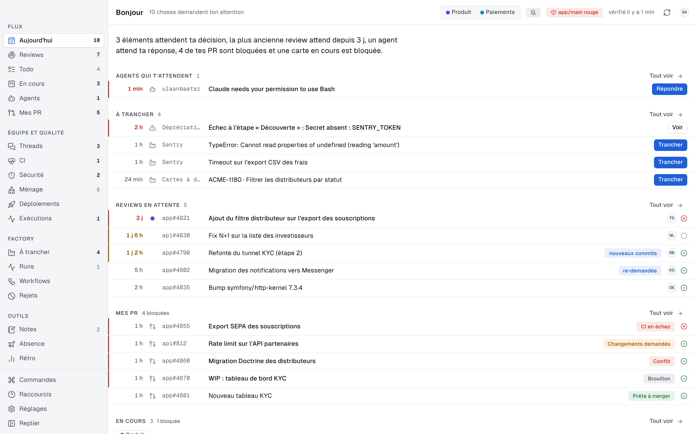

### Reviews
Les PR où ta review est demandée ou à refaire et les cartes « To Review », les plus anciennes
d'abord. j et k circulent, Entrée ouvre.

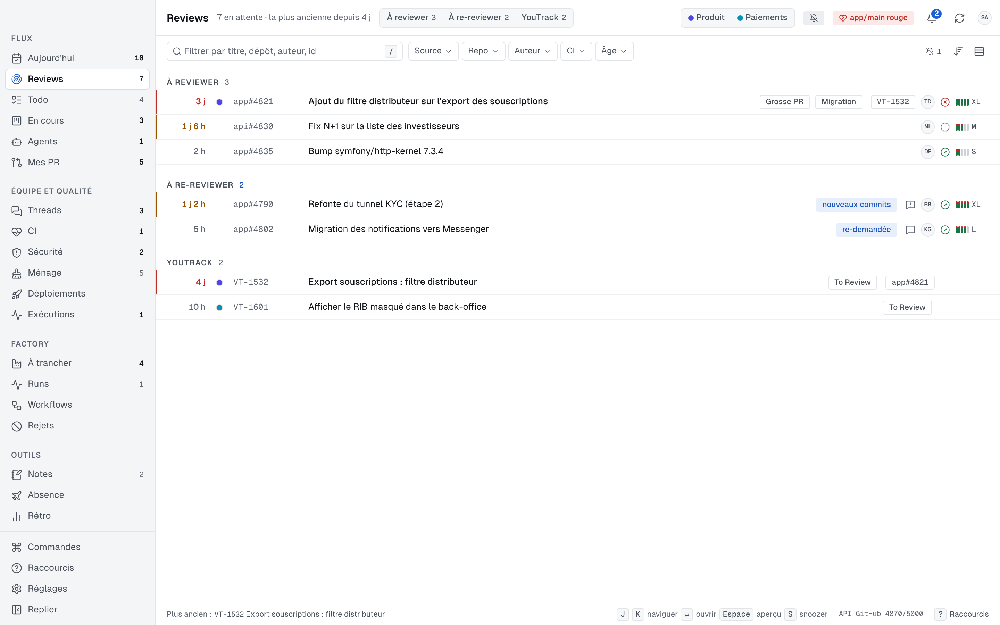

### Mes PR
Tes PR ouvertes : approbations, changements demandés, CI, conflits et threads non résolus.

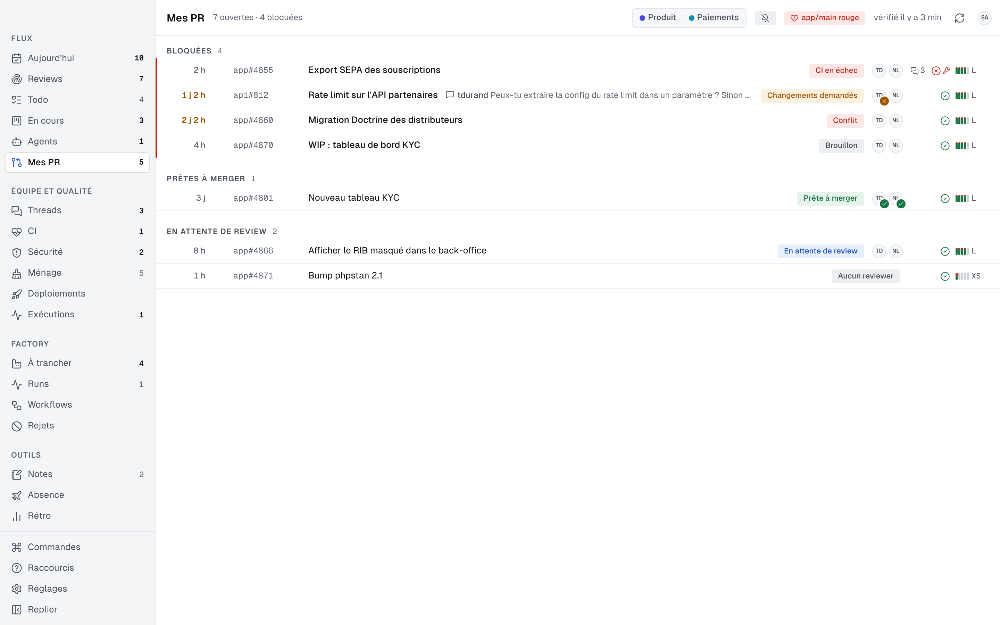

### En cours
Tes cartes de la branche jusqu'au merge, avec l'étape atteinte et ce qui bloque.

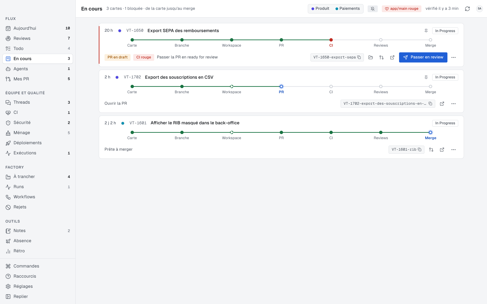

### Agents
Tes sessions Claude Code ; celles qui attendent une réponse passent devant.

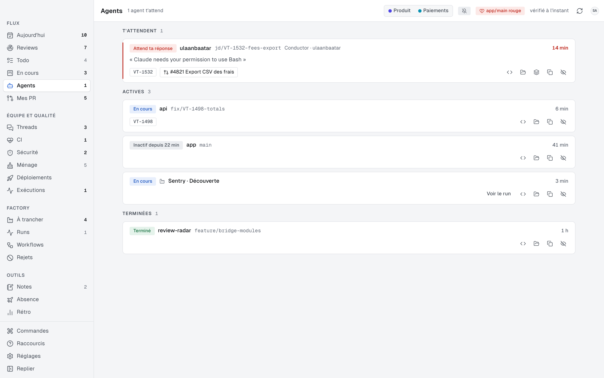

### Threads
Les fils où tu es attendu : réponses, mentions, threads non résolus sur tes PR.

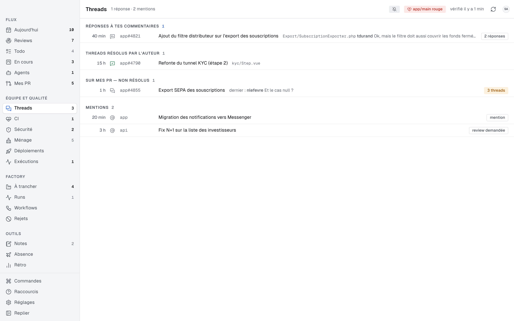

### CI
La santé de la CI sur main, les workflows qui cassent le plus souvent et les jobs instables.

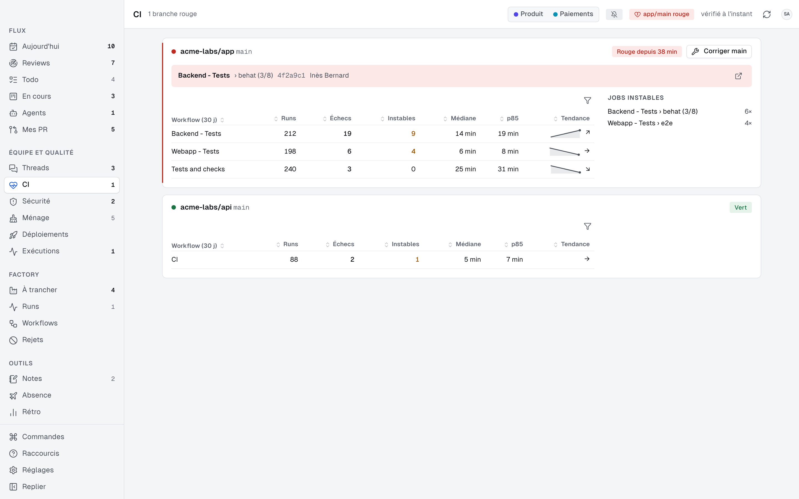

### Déploiements
Ce qui est parti en recette ou en production, et ce qui attend encore.

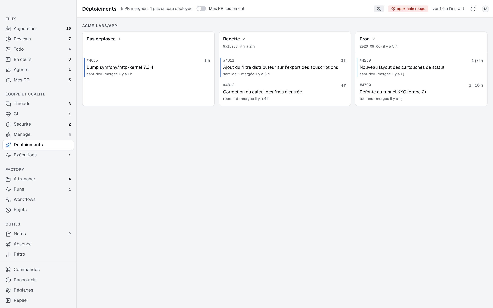

### Factory
Les sorties des agents à trancher : accepter, rejeter ou reporter, brouillon de carte à l'appui.

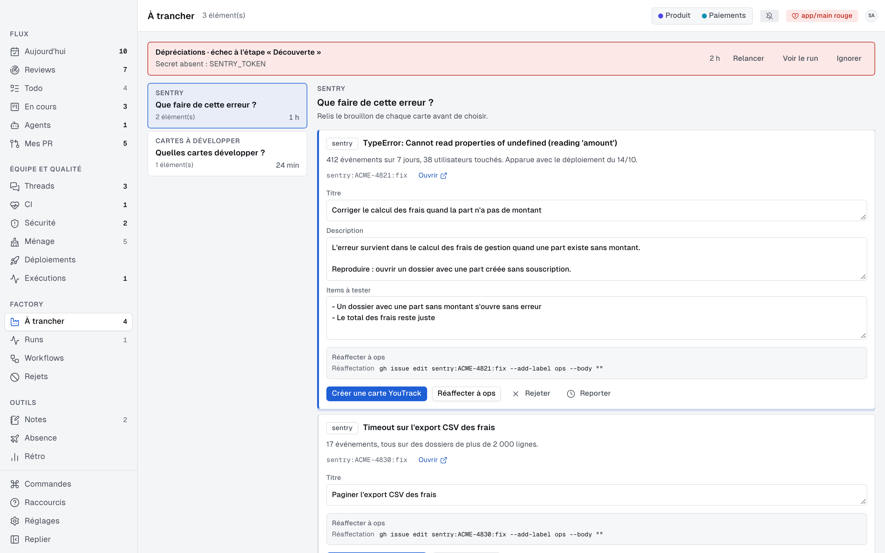

### KPI de fabrication
Débit, durées et fluidité par sprint, par équipe et par période.

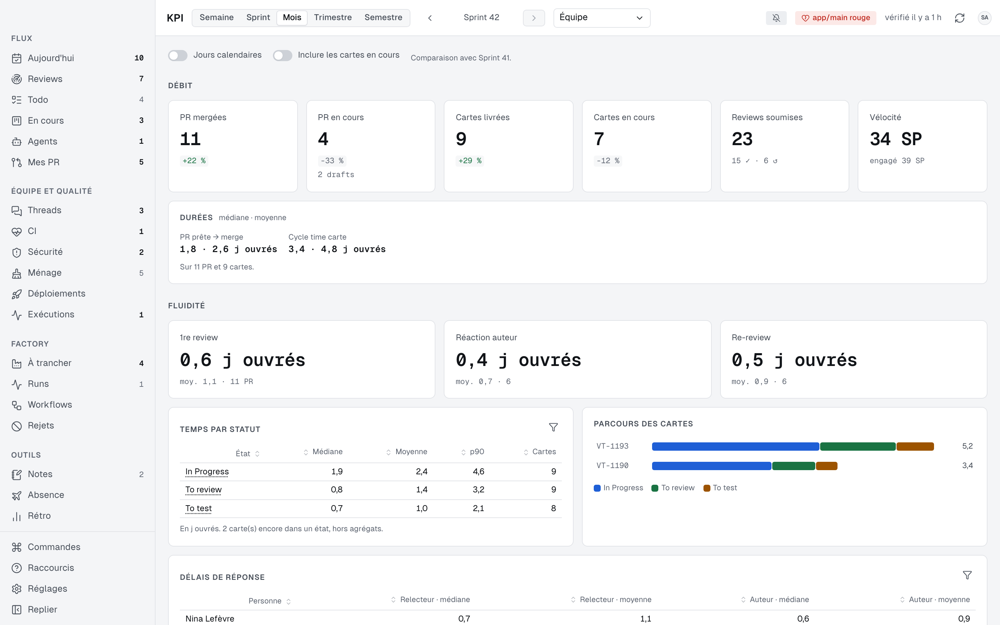

### Indicateurs
Tes propres chiffres face à ceux de l'équipe, calculés sur ta machine.

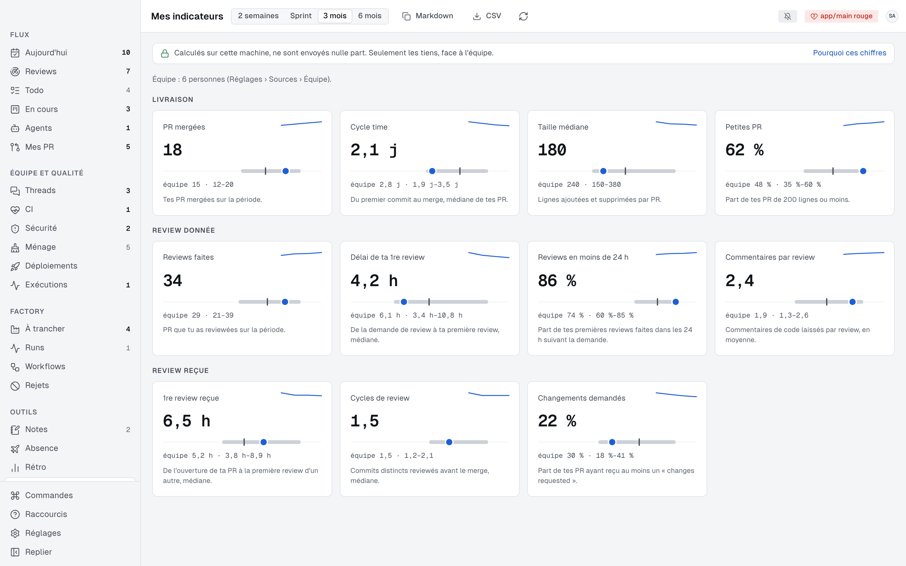

### Composer son cockpit
Les modules s'activent un par un, avec leurs dépendances et des profils tout faits.

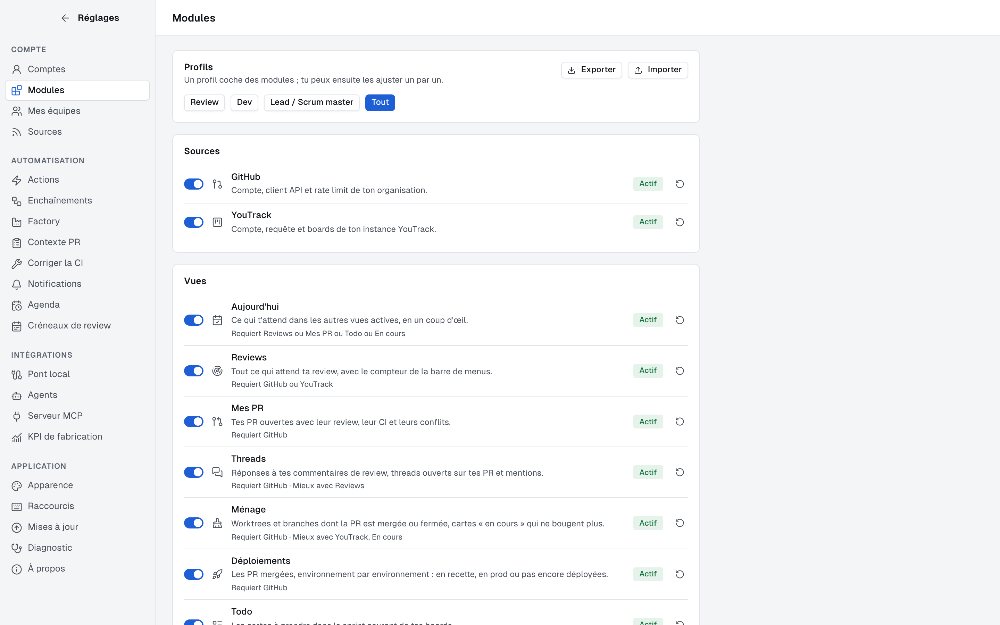

### Visite guidée
Au premier lancement, un pas à pas éclaire les zones de l'app une à une. Il se relance depuis la
palette (⌘K) ou l'aide (?).

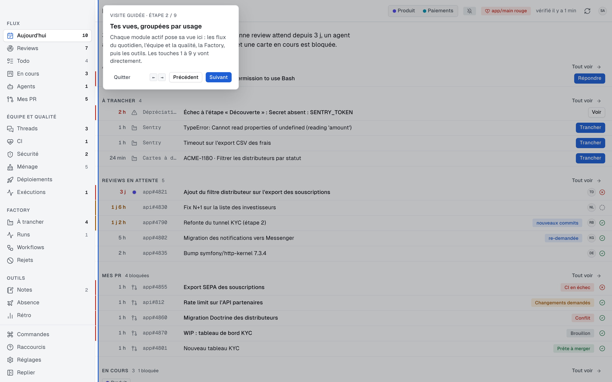

## Installer

```bash
gh api repos/jeremie-vasco/dev-cockpit-dist/contents/install.sh --jq .content | base64 --decode | bash
```

`--beta` pour le canal beta, `--version vX.Y.Z` pour une version précise, `--deb` sous Linux pour
le paquet plutôt que l'AppImage. Les versions suivantes arrivent dans l'app, toutes seules.

## Ce que porte une release

| Fichier | Pour |
|---|---|
| `Dev.Cockpit_<version>_universal.app.tar.gz` + `.sig` | macOS, c'est ce que l'updater installe |
| `Dev.Cockpit_<version>_universal.dmg` | macOS, première installation à la main |
| `Dev.Cockpit_<version>_amd64.AppImage` + `.sig` | Linux, mise à jour automatique |
| `Dev.Cockpit_<version>_amd64.deb` + `.sig` | Linux, paquet (root, mises à jour manuelles) |
| `latest.json` | le manifeste que l'app lit : version, notes, signature par plateforme |

Chaque artefact est signé (minisign). L'app vérifie la signature avec sa clé publique intégrée et
refuse toute mise à jour dont la signature ne correspond pas.

La release fixe `remote-config` porte la configuration distante signée, que les apps relisent
toutes les heures.
